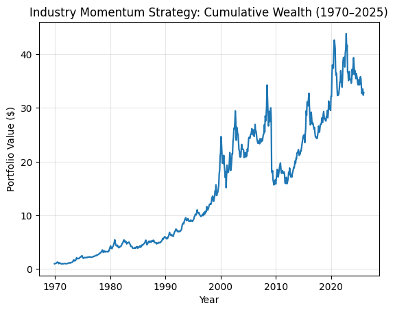
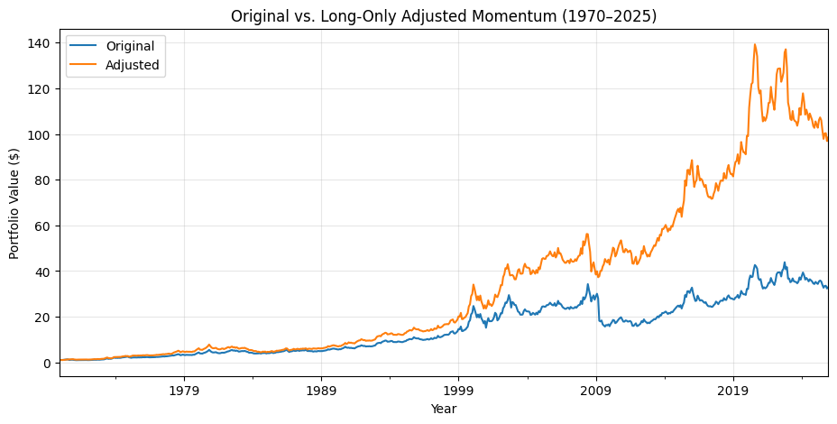
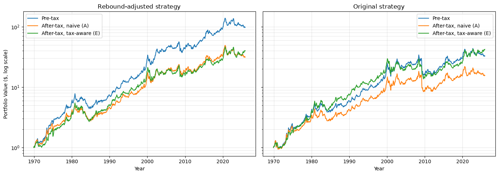

# Industry Momentum: An Exploratory Tryout

> **Status: exploratory.** This is a first pass at a well-known anomaly, built to learn the full workflow: signal construction, factor-model alphas, crash behavior, and after-tax implementation. It is **not** a finished research result. The strategy tweaks were designed with the full sample in view, trading costs are ignored, and nothing has been tested out of sample. [Next steps](#next-steps) lists what I plan to do about that.

[](https://colab.research.google.com/github/dengyuhe/industry-momentum-tryout/blob/main/industry_momentum.ipynb)

## What it does

| | |
|---|---|
| **Universe** | 49 Fama-French value-weighted industry portfolios, Jan 1970 – Dec 2025 (672 months) |
| **Signal** | 12-2 momentum: cumulative return from month *t*−12 to *t*−2, skipping *t*−1 to avoid short-term reversal |
| **Portfolio** | Long the top 10 and short the bottom 10 industries, equal-weighted, rebalanced monthly |
| **No look-ahead** | Weights for month *t* use returns through *t*−2 only |
| **Evaluation** | Geometric return, drawdown, FF3 / FF5 alphas with Newey-West (6 lags) standard errors |

## Findings so far

**1. The baseline strategy earns a sizable gross premium that standard factors don't explain.**
$1 grows to $32.88 (0.52% per month geometric, 6.4% a year). Alphas are 0.83% per month against FF3 (t = 4.8) and 0.74% against FF5 (t = 3.8), with R² below 0.08. These are gross returns, before any frictions.

<p align="center"></p>

**2. Losses come from crashes in the short leg.**
The maximum drawdown is −54%. The worst month, April 2009, lost 35% when the loser industries rebounded 36% in a single month. All five of the worst months share this pattern.

**3. A simple rebound filter helps in-sample, but partly by adding market exposure.**
When the market's past-12-month return is negative and last month's return is positive, the short leg is closed (63 of 672 months). This raises the return to 0.69% per month ($98.44 terminal value) and cuts the drawdown to −44%. The signal itself is unchanged, the book becomes net long in those months, and the rule was designed after seeing 2009, so I treat this as a hypothesis rather than a result.

<p align="center"></p>

**4. Taxes take a quarter of the return; smarter execution recovers part of it.**
I built a lot-level capital-gains engine. It tracks each tax lot, applies short- vs long-term rates (35% / 20%), nets gains and losses, and carries losses forward. A zero-tax check confirms it reproduces the pre-tax wealth path exactly.

| Execution (rebound-adjusted strategy) | Pre-tax (%/mo) | After-tax (%/mo) | Tax drag | Turnover (×/yr) | Long-term share of gains |
|---|---:|---:|---:|---:|---:|
| A. Naive: monthly rebalance, FIFO lots | 0.685 | 0.515 | 24.8% | 12.2 | 23% |
| B. + sell lowest-tax-cost lots first | 0.685 | 0.523 | 23.6% | 12.2 | 27% |
| C. + trade only on entry/exit | 0.634 | 0.476 | 24.9% | 10.9 | 36% |
| D. + symmetric hold buffer (rank 20) | 0.599 | 0.472 | 21.2% | 5.0 | 59% |
| **E. + asymmetric buffer: cut losers, let winners run** | **0.694** | **0.552** | **20.5%** | **7.0** | **59%** |

The asymmetric rule (E) holds up across buffer widths from 14 to 30, every tax-rate pair tested, and both sub-periods. A symmetric buffer does not. An interesting twist: once execution is tax-aware, the rebound filter no longer helps after tax (0.552% vs 0.559% for the original strategy).

<p align="center"></p>

## Next steps

What I would do before treating any of this as a research result:

- **Out-of-sample discipline.** Re-test the rebound filter on a holdout period or with expanding windows. Compare it with established crash hedges: volatility-scaled momentum (Barroso & Santa-Clara, 2015) and dynamic momentum (Daniel & Moskowitz, 2016).
- **Market neutrality.** Hedge the market beta the rebound rule introduces, so the comparison isolates the signal.
- **Costs.** Add transaction and short-borrow costs. At 7–12× annual turnover, they could absorb much of the edge.
- **Fuller reporting.** Add volatility, Sharpe ratio, skewness, and alphas against UMD and short-term reversal. Add block-bootstrap confidence intervals for strategy differences.
- **Signal design.** Test sensitivity to the formation window (6-1, 12-1), breadth (5 / 10 / 15 industries) and weighting, correcting for the number of variants tried.
- **Industry vs. stock momentum.** Following Moskowitz & Grinblatt (1999), measure how much of stock-level momentum this industry signal captures, using CRSP data.

## Run it

Click the Colab badge above, or run it locally:

```bash
git clone https://github.com/dengyuhe/industry-momentum-tryout.git
cd industry-momentum-tryout
pip install -r requirements.txt
jupyter notebook industry_momentum.ipynb
```

The notebook downloads the three data files from the [Kenneth R. French Data Library](https://mba.tuck.dartmouth.edu/pages/faculty/ken.french/data_library.html) into `data/` on first run. French updates the library periodically, so a fresh download can shift results slightly.

## Contact

Maggie Deng · [LinkedIn](http://www.linkedin.com/in/maggie-deng-52314a2b3) · [GitHub](https://github.com/dengyuhe)
